# SportsAgenticInference

Python FastAPI OpenAI-compatible inference server that manages `llama-server` (`llama.cpp`) and **`microsoft/Phi-4-mini-instruct`** (GGUF) as the primary local LLM backend for **`SportsAgenticAgent`**.

It exposes:
1. **`GET /health`** (`:8081/health`) — Verifies the GGUF model artifact and probes the managed `llama-server` subprocess (`:8082`).
2. **`GET /v1/models`** (`:8081/v1/models`) — Lists `microsoft/Phi-4-mini-instruct` and the `local-model` alias expected by `SportsAgenticAgent`.
3. **`POST /v1/chat/completions`** (`:8081/v1/chat/completions`) — Proxies OpenAI-compatible chat and MCP tool-calling requests to `llama-server` (`--jinja`) and normalizes `Phi-4-mini-instruct` tool-call responses into standard OpenAI `tool_calls`.

---

## Architecture



The service acts as an OpenAI-compatible gateway (`:8081`) fronting an internal supervised `llama-server` process (`:8082`):
- **FastAPI Gateway**: Serves `/health`, `/v1/models`, and `/v1/chat/completions` (supporting both synchronous JSON responses and SSE token streaming).
- **Process Supervision** (`app/process_manager.py`): Manages the `llama-server` subprocess lifecycle (spawning with Metal/ARM/CPU flags, stdout/stderr streaming, health polling, and clean SIGTERM/SIGKILL shutdown).
- **Model Acquisition** (`app/model_manager.py`): Ensures GGUF model artifacts (`Qwen2.5-14B-Instruct` or `microsoft/Phi-4-mini-instruct`) are present, downloading them automatically from Hugging Face Hub if missing.
- **Inference Proxy & Normalizer** (`app/proxy.py`): Forwards requests upstream and normalizes model tool-calling outputs (special tokens, JSON fences, inline objects, and Python syntax) into standard OpenAI `tool_calls` schemas, while filtering streaming SSE chunks so text never leaks during tool calls.

---

## Setup

```bash
# 1. Create and activate a virtual environment
python3 -m venv .venv
source .venv/bin/activate

# 2. Install runtime and test dependencies
pip install -r requirements-dev.txt

# 3. Configure environment variables
cp .env.example .env
```

---

## Running the FastAPI Inference Server

```bash
uvicorn app.main:app --host 0.0.0.0 --port 8081 --reload
```

On startup (`AUTO_START_LLAMA_SERVER=true`), the service automatically:
1. Checks `MODEL_CACHE_DIR` (`./models` locally, `/models` in Docker/Kubernetes) for `microsoft_Phi-4-mini-instruct-Q4_K_M.gguf` and downloads it via `huggingface_hub` if missing.
2. Spawns `llama-server` on `127.0.0.1:8082` with `--jinja` enabled.
3. Serves OpenAI-compatible endpoints on `0.0.0.0:8081`.

---

## Containerization (Docker & Docker Compose)

Build and run with Docker Compose (persists downloaded GGUF weights in the `model-cache` volume):

```bash
cp .env.example .env
docker compose up --build
```

Or build and run the image directly:

```bash
docker build -t sportsagentic-inference:latest .
docker run --rm -p 8081:8081 -v sportsagentic-models:/models --env-file .env sportsagentic-inference:latest
```

---

## Kubernetes Deployment (Helm)

A Helm chart is provided in [`charts/sportsagentic-inference`](./charts/sportsagentic-inference). By default, `fullnameOverride` is set to `llama-server` on port `8081` so `SportsAgenticAgent` (`http://llama-server:8081/v1`) connects out of the box.

```bash
# Lint and preview rendered manifests
helm lint charts/sportsagentic-inference
helm template llama-server charts/sportsagentic-inference

# Install or upgrade the release
helm upgrade --install llama-server charts/sportsagentic-inference \
  --namespace sportsagentic --create-namespace
```

To schedule onto the dedicated `model-pool` nodes in `SportsAgenticInfra`:

```bash
helm upgrade --install llama-server charts/sportsagentic-inference \
  --namespace sportsagentic --create-namespace \
  --set nodeSelector.workload-role=model
```

---

## API Endpoints

### `POST /v1/chat/completions`
Execute an OpenAI-compatible chat completion or MCP tool-calling request.

```bash
curl -s http://localhost:8081/v1/chat/completions \
  -H "Content-Type: application/json" \
  -d '{
    "model": "local-model",
    "messages": [
      {"role": "system", "content": "You are a college football assistant."},
      {"role": "user", "content": "What was the score of the Ole Miss game?"}
    ]
  }'
```

Set `"stream": true` to receive OpenAI-style `chat.completion.chunk` events over `text/event-stream` as `llama-server` produces them:

```bash
curl -N http://localhost:8081/v1/chat/completions \
  -H "Content-Type: application/json" \
  -d '{
    "model": "local-model",
    "stream": true,
    "messages": [{"role": "user", "content": "Who is the head coach of Ole Miss?"}]
  }'
```

- The status code is sent after `llama-server`'s first event, so failures up to that point return the usual `502`/`503`/`504`.
- A later failure ends the stream with an `error:` line and no `data: [DONE]`. Treat a stream with no `finish_reason` or `[DONE]` as failed.
- Text that could be an inline tool call is held back, then sent as a `tool_calls` delta with `finish_reason: "tool_calls"`. Narration before the call is sent as normal text.
- `LLAMA_REQUEST_TIMEOUT_SECONDS` limits the wait for the first token and each gap between chunks, not the length of the whole reply.
- If the client disconnects, the upstream request is closed so `llama-server` stops generating.

### `GET /v1/models`
List available model identifiers (`microsoft/Phi-4-mini-instruct` and `local-model`).

```bash
curl -s http://localhost:8081/v1/models
```

### `GET /health`
Check GGUF model presence and `llama-server` readiness (returns HTTP `200` when ready, `503` while loading or degraded).

```bash
curl -s http://localhost:8081/health
```

---

## Running the Test Suite

```bash
pytest -v
```

